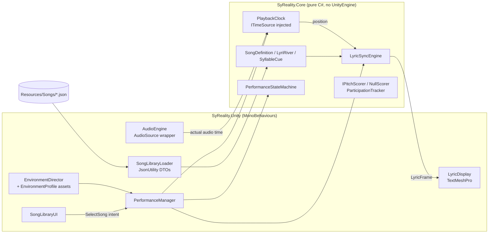
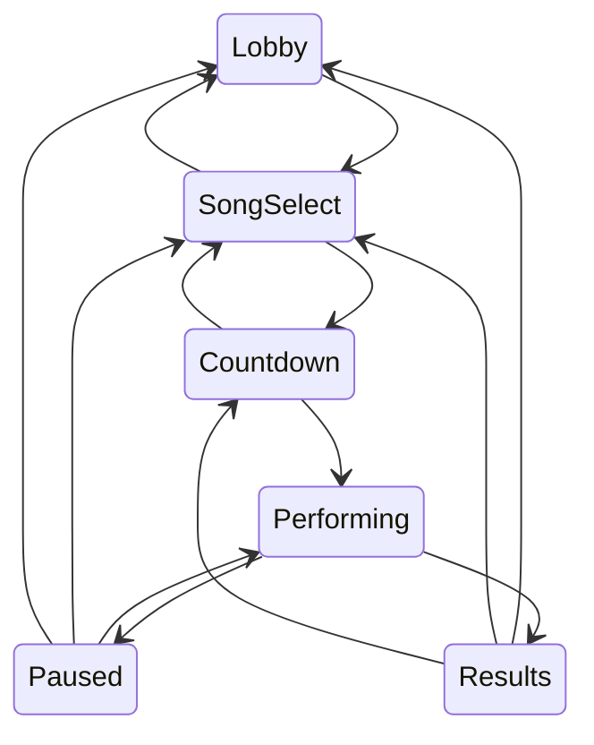

# Sy-Reality! Architecture

## Design principle

Everything deterministic lives in a pure C# core with zero UnityEngine
dependencies (`SyReality.Core`, `noEngineReferences: true`). The Unity layer
is a thin binding: it renders what the core decides and forwards intents.
This design is what makes the karaoke timing logic unit testable headlessly
(plain .NET) and in Unity's Test Framework with the same test sources. The
headless tests have run. The in editor tests have not.

## Module map

| Module | Responsibility |
| --- | --- |
| `Core/SongData.cs` | Data model plus structural validation (ordered, non-overlapping lines and syllables, within duration, rights note carried on every song) |
| `Core/LyricSyncEngine.cs` | Stateless function of time to `LyricFrame` (active line, progress, next line, syllable plus char-level highlight). Binary search over lines |
| `Core/PlaybackClock.cs` | Position with play, pause, resume, restart, and seek over an injectable `ITimeSource`; drift measurement plus threshold snap correction against reported audio time |
| `Core/PerformanceStateMachine.cs` | Explicit transition table; invalid transitions rejected, logged, and surfaced as events |
| `Core/Scoring.cs` | Optional-extension seam: `IPitchScorer`, honest `NullScorer`, and timing-based `ParticipationTracker` (line completion, never presented as vocal quality) |
| `Unity/PerformanceManager.cs` | Owns core objects; intents (`OpenSongSelect`, `SelectSong`, `PausePerformance`, and others) are the only way flow changes; per-frame drift feed plus frame render |
| `Unity/AudioEngine.cs` | AudioSource wrapper; loads user-licensed files from StreamingAssets/Audio; silent test mode when no clip |
| `Unity/SongJson.cs` | JsonUtility DTOs plus `SongLibraryLoader`, which loads song JSON from Resources and converts it to core `SongDefinition` values |
| `Unity/LyricDisplay.cs` | TMP rendering: previous, current, and next lines, rich-text highlight split at the engine's char count, progress bar |
| `Unity/SongLibraryUI.cs` | Song list UI; loads songs through `SongLibraryLoader` and forwards the selected song to PerformanceManager |
| `Unity/EnvironmentDirector.cs` | Applies `EnvironmentProfile` ScriptableObjects (3 stages: Neon Club, Sunset Rooftop, Cosmic Stage). Environments are data |
| `Editor/SceneBuilder.cs` | Generates MainStage scene plus profiles plus prefab from code; the scene is reproducible from the repo |

## Timing and synchronization design

Karaoke sync fails in two ways: the clock being wrong, and the lookup
being wrong. They are solved separately in the code. Neither has been
verified running in Unity yet.

1. **Lookup.** `LyricSyncEngine` is stateless: frame = f(song, t). Seek,
   pause, and restart need no special cases; there is no accumulated state
   to desynchronize.
2. **Clock.** `PlaybackClock` advances from an injected time source, but the
   audio is the audible reference. Each frame during Performing, the manager
   reports the AudioSource's actual `time`; drift beyond 0.15s snaps the
   clock base to the audio position and increments an observable correction
   counter. MP3 encoder delay and device audio latency show up as drift and
   are absorbed by the same mechanism, in theory. The threshold and the
   correction path are tested headlessly against a fake time source, not
   against real audio.
3. **Countdown.** The performance clock starts at 0 in the same frame
   audio playback starts (after the countdown coroutine), so the countdown
   cannot eat into song time. This is the code path in PerformanceManager;
   it has not been observed running.

## Performance state diagram

Any transition not drawn here is rejected by the state machine (with a log
line and a `TransitionRejected` event the UI can surface). The transition
table itself is covered by the headless tests.

## Testing strategy

- `Assets/SyReality/Tests/EditMode/` contains NUnit suites for the sync
  engine (boundaries, gaps, seek, syllable highlight), the clock (pause
  freeze, seek, drift threshold plus snap), the state machine (happy path
  plus invalid transitions), and scoring honesty (NullScorer never
  fabricates).
- `tools/CoreTests/` is a plain .NET test project that compiles the same
  core plus test sources, so the logic can be verified on any machine with
  the .NET SDK, including CI without a Unity license. STATUS.md records
  which runner produced which results.
